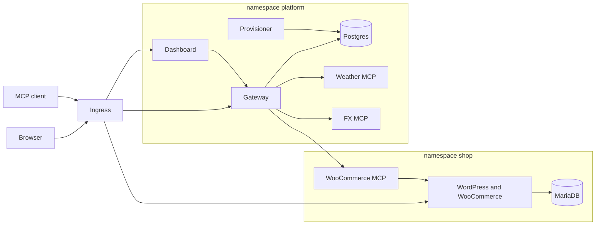

# AgentDock

WooCommerce on Kubernetes, with a team MCP gateway in front of it. An admin registers MCP servers once. Every teammate uses them through one gateway URL, or through the chat agent in the dashboard.

The WooCommerce MCP server in this repo is ours. It speaks Streamable HTTP and calls the store with the WooCommerce REST API. Weather and FX are two more upstreams so the gateway has three servers to aggregate.

A user can also create more stores from the dashboard. Each one is provisioned in its own namespace and registered with the gateway.

## Public deployment

The same Helm chart is running on a k3s node. TLS is cert-manager with Let's Encrypt.

| | |
| --- | --- |
| Storefront | https://shop.34.203.65.66.nip.io |
| WordPress admin | https://shop.34.203.65.66.nip.io/wp-admin |
| Dashboard | https://app.34.203.65.66.nip.io |
| MCP endpoint | https://app.34.203.65.66.nip.io/mcp |

Gateway login is `admin@agentdock.local`. WordPress admin user is `shopadmin`. Passwords are in Kubernetes Secrets, not in this file. On the node:

```bash
sudo k3s kubectl -n platform get secret gateway -o jsonpath="{.data.ADMIN_PASSWORD}" | base64 -d; echo
sudo k3s kubectl -n shop get secret shop -o jsonpath="{.data.WORDPRESS_ADMIN_PASSWORD}" | base64 -d; echo
```

WooCommerce, Weather, and FX are already registered. An external client needs only `https://app.34.203.65.66.nip.io/mcp` and a Bearer key. It does not get the store, weather, or FX addresses.

Local Kind uses the same chart. Local URLs are `https://shop.localtest.me`, `https://app.localtest.me`, and `https://app.localtest.me/mcp`.

## Definition of done

Use two users. User A is the admin above. User B is a member invited from Members.

1. **Store.** Open the storefront, add Classic Tee, check out with cash on delivery, and confirm the order in WordPress admin.
2. **Chat, as user A.** Ask the agent to create a product with a name and a price. It appears on the storefront. Place an order for it by hand, then ask what orders came in today.
3. **External client, as user B.** Connect Cursor, Claude Code, or MCP Inspector with only the gateway URL and user B's API key. `tools/list` shows every enabled server. Ask the same orders question, then one prompt that needs two upstreams.
4. **Control.** Revoke user B's key (next call is 401). Disable Weather (its tools leave Chat and `tools/list`). Delete the Weather pod (the dashboard shows Unreachable, and the other servers keep answering). The audit log lists who called which server and tool, when, how long, and whether it succeeded.

The sections below are the click-by-click version of that flow.

## Architecture

One Helm chart, `deploy/helm/urumi`, installs every workload. Local Kind and the public k3s node run that same chart. The difference is the values file: ingress class, hostnames, TLS, image tags, and the secrets file.



Public traffic stops at the Ingress. The shop host goes to WordPress. The app host sends `/` to the dashboard and `/api` and `/mcp` to the gateway. MariaDB, Postgres, and every MCP Service are ClusterIP. NetworkPolicies are what stop anything except the gateway from opening the MCP Services.

Inside the cluster the path for a store tool is: the caller hits the gateway, the gateway checks the API key or the OAuth token, the gateway opens its own Streamable HTTP client to the WooCommerce MCP server, and that server calls the WooCommerce REST API on WordPress. WordPress reads and writes MariaDB. Weather and FX follow the same gateway hop and then call Open-Meteo and Frankfurter. Chat adds one more hop: the gateway sends the conversation to Groq, Groq asks for a tool, and the gateway runs that tool as the signed-in user.

Extra stores repeat the shop shape in a `store-<slug>` namespace. The provisioner creates them from a Postgres row. Hosted MCP images repeat a smaller shape in a `hosted-<slug>` namespace: one Deployment, one Service, and a NetworkPolicy that admits only the gateway.

## What runs where

| Namespace | Workload | Reachable from |
| --- | --- | --- |
| `shop` | MariaDB (PVC) | WordPress and the bootstrap Job |
| `shop` | WordPress + WooCommerce (PVC) | Ingress, and the WooCommerce MCP server |
| `shop` | WooCommerce MCP server | Gateway pods only |
| `platform` | Postgres (PVC) | Gateway and the provisioner |
| `platform` | Gateway | Ingress `/api` and `/mcp` |
| `platform` | Provisioner | Kubernetes API. Creates `store-*` and `hosted-*` namespaces |
| `platform` | Dashboard | Ingress `/` |
| `platform` | Weather MCP, FX MCP | Gateway pods only |

Every Deployment has a readiness probe, a liveness probe, and CPU and memory requests and limits. The numbers are `resources` in `deploy/helm/urumi/values.yaml`. MariaDB (5Gi), WordPress (5Gi), and Postgres (2Gi) use PersistentVolumeClaims on StorageClass `local-path`. Passwords, the WooCommerce consumer key, the Groq key, and the credential encryption key are Kubernetes Secrets (`deploy/helm/urumi/templates/secrets.yaml`). Nothing secret is baked into an image or a committed values file.

NetworkPolicies enforce the "only the gateway" rows. They start from default-deny in `shop`, `platform`, each `store-*` namespace, and each `hosted-*` namespace. The allows are DNS, the ingress controller, the gateway, and each database's own clients. Kind 0.33's kindnet enforces those policies. k3s enforces them with kube-router. `kube-system` and the ingress namespace stay open so DNS and the ingress controller keep working.

WordPress runs as uid 33 and listens on 8080. MariaDB runs as uid 999. Postgres runs as uid 70. The Node services run as uid 1000. The Service in front of WordPress is still port 80. It targets the named port on 8080, because uid 33 cannot bind port 80.

## Why these choices

The store is stock WordPress plus WooCommerce, on persistent volumes, so the assignment is a real stateful app. The WooCommerce MCP server in this repo is the one we wrote. It speaks Streamable HTTP and calls REST with the consumer key. REST stays on HTTP, so the gateway's timeout bounds a slow store call, and the MCP server never execs into the WordPress container.

The gateway is both an MCP client and an MCP server. Teammates and the chat agent have one URL. Upstream URLs and consumer keys stay in Postgres as AES-GCM ciphertext, or in the Kubernetes Secret mounted on that MCP pod. The caller's `urk_` key is checked and then dropped. It is not copied onto the upstream request.

Tool names are `{slug}__{tool}`. Two stores can both expose `list_orders` and the gateway can still tell them apart. `tools/list` asks every enabled server at once and keeps the ones that answer within 3 seconds, so one dead upstream does not empty the catalog. A tool call times out after 20 seconds and comes back as a tool error. The gateway process stays up.

MCP sessions are stateless. Each request builds a new transport (`sessionIdGenerator` unset, JSON responses), and the tokens live in Postgres. The gateway Deployment runs two replicas, and either replica can serve the next call. There is no session affinity.

Public TLS is cert-manager with a Let's Encrypt ClusterIssuer named `letsencrypt`. The certificate is stored as `agentdock-tls`. Local Kind uses a certificate trusted on this computer, because Let's Encrypt cannot validate `localtest.me`.

Chat uses Groq (`openai/gpt-oss-120b`). The key is `secrets.groqApiKey`, mounted only on the gateway. When the catalog grows past 8 tools, the model is given `search_tools` and `call_tool` only. `search_tools` queries an inverted index of names and descriptions in `apps/gateway/src/search.ts`.

There are two roles. An admin manages servers, members, and every tool. A member uses an allow list of bare tool names. Keys are stored as SHA-256. The audit log is in the dashboard.

Longer notes are in [System design and tradeoffs](#system-design-and-tradeoffs) and [Threat model](#threat-model) below, and in `docs/system-design.md` and `docs/threat-model.md`.

## Local setup

Install Docker Desktop, [kind](https://kind.sigs.k8s.io/) 0.33 or newer, kubectl, Helm 3, and Node 22 or newer. Ports 80 and 443 on the host must be free. Kind 0.33 is the version whose kindnet enforces NetworkPolicy.

```powershell
.\deploy\scripts\up-local.ps1
```

On bash:

```bash
bash deploy/scripts/up-local.sh
```

The script creates a Kind cluster named `agentdock`, installs the local-path provisioner and ingress-nginx, builds the six app images (`woocommerce-mcp`, `weather-mcp`, `fx-mcp`, `gateway`, `dashboard`, `provisioner`), loads them into Kind, generates `deploy/helm/urumi/secrets.local.yaml` if it is missing, and installs the chart with `values-local.yaml`.

The PowerShell script then runs `deploy/scripts/local-tls.ps1`, which installs a certificate for `*.localtest.me` and trusts it for the current Windows user. Plain `http://` redirects to `https://`, and the browser shows the lock. The bash script does not install that trust; the chart still serves HTTPS, and the browser will warn until the certificate is trusted.

Local domains use [localtest.me](https://localtest.me), which resolves `*.localtest.me` to `127.0.0.1`. No hosts-file entry is required when that DNS name resolves. If you are offline, add:

```
127.0.0.1 shop.localtest.me app.localtest.me
```

Kind maps host ports 80 and 443 to the ingress controller (`deploy/kind/cluster.yaml`).

Paste a Groq API key into `secrets.groqApiKey` in `secrets.local.yaml` before you use chat, then upgrade:

```powershell
helm upgrade agentdock deploy/helm/urumi -n agentdock --timeout 20m -f deploy/helm/urumi/values-local.yaml -f deploy/helm/urumi/secrets.local.yaml
```

`secrets.local.yaml` is gitignored. `secrets.example.yaml` shows the shape. Passwords are generated. Read them with:

```powershell
kubectl -n platform get secret gateway -o jsonpath="{.data.ADMIN_PASSWORD}" | %{ [Text.Encoding]::UTF8.GetString([Convert]::FromBase64String($_)) }
kubectl -n shop get secret shop -o jsonpath="{.data.WORDPRESS_ADMIN_PASSWORD}" | %{ [Text.Encoding]::UTF8.GetString([Convert]::FromBase64String($_)) }
```

Gateway login is `admin@agentdock.local` plus `ADMIN_PASSWORD`. WordPress admin user is `shopadmin` plus `WORDPRESS_ADMIN_PASSWORD`.

The bootstrap Job installs WooCommerce, enables cash on delivery, and creates a sample product named Classic Tee. Watch it with:

```powershell
kubectl -n shop logs job/wc-bootstrap
```

## Place an order

1. Open the storefront (`https://shop.localtest.me`, or the public storefront above).
2. Open Classic Tee, add it to the cart, and check out.
3. Pay with cash on delivery. Guest checkout is enabled.
4. Confirm the order in WordPress admin at `/wp-admin` on the same host.

## Chat agent

Sign in to the dashboard as the admin (user A). Open Chat.

Ask it to create a product with a name and a price, for example: "Create a product called Running Shoes for 49.00". The product should appear on the storefront. Place an order for it by hand, then ask: "What orders came in today?" The agent calls `woocommerce__list_orders`. The tool names it used are shown on the reply, and the audit log attributes the calls to that user.

The chat loop runs in the gateway (`apps/gateway/src/chat.ts`) under the logged-in user id. The dashboard session is an HttpOnly cookie. The model is not given that cookie or any upstream credential.

A prompt that needs two upstreams: "What is today's order total in EUR?" That uses WooCommerce and `fx__convert`.

## External MCP client

Invite a second user on Members (role member). Sign in as that user and create an API key. The full key is shown once. Postgres stores SHA-256 and a short prefix.

In Cursor, Claude Code, or MCP Inspector, add one server:

- URL: `https://app.localtest.me/mcp` locally, or `https://app.34.203.65.66.nip.io/mcp` on the public node
- Header: `Authorization: Bearer urk_...`

`tools/list` returns every enabled server, with names prefixed by the server slug (`woocommerce__list_orders`, `weather__get_forecast`, `fx__convert`). Ask the same orders question, then a prompt that needs two servers.

There is no setting for the WooCommerce, weather, or FX URLs in the client. Those credentials stay on the gateway. A member's list hides tools outside the allow list.

OAuth is available beside API keys. Discovery is `/.well-known/oauth-protected-resource` and `/.well-known/oauth-authorization-server`. The flow is authorization code with PKCE (`apps/gateway/src/oauth.ts`).

## Revoke, disable, kill

- Revoke user B's key on API keys. The next MCP call returns 401.
- Disable Weather. Its tools disappear from Chat and from `tools/list`. WooCommerce and FX still answer.
- `kubectl -n platform delete pod -l app.kubernetes.io/name=weather-mcp`. Within about 10 seconds the dashboard shows Weather as unreachable, with the error string. The other servers keep working. Click Refresh status if you do not want to wait for the poller.
- Audit log lists who called which server and tool, when, how long, and whether it succeeded. Admins see every row. Members see their own.

## Production-like VPS (k3s)

The public URLs at the top are this install. `deploy/helm/urumi/values-prod.yaml` is the same chart with placeholders (`shop.example.com`, `app.example.com`). On the live node those four host and URL fields are the nip.io names. k3s already provides Traefik and the `local-path` StorageClass. Do not install ingress-nginx there.

1. Install k3s and Helm 3. The default k3s install keeps Traefik.

```bash
curl -sfL https://get.k3s.io | sh -
```

2. Build the six images and import them (or push them to a registry and change the tags):

```bash
for image in woocommerce-mcp weather-mcp fx-mcp gateway dashboard provisioner; do
  docker build -t "agentdock/${image}:1.0.0" "apps/${image}"
  docker save "agentdock/${image}:1.0.0" | sudo k3s ctr images import -
done
```

Set `ingress.shopHost`, `ingress.appHost`, `wordpress.url`, and `gateway.publicUrl` in `values-prod.yaml` to the real names, and point DNS (or a nip.io name) at the VPS. `stores.hostSuffix` needs a wildcard name if you create extra stores.

3. Install cert-manager and a Let's Encrypt ClusterIssuer named `letsencrypt`. The prod values set `ingress.tls.certManager: true`, so the Ingress asks cert-manager for the certificate Secret `agentdock-tls`. Keep HTTP-01 reachable: do not redirect port 80 to HTTPS on the Traefik entrypoint itself. The chart adds a redirect middleware on the shop and dashboard Ingress only.

```bash
kubectl apply -f https://github.com/cert-manager/cert-manager/releases/latest/download/cert-manager.yaml
```

```yaml
apiVersion: cert-manager.io/v1
kind: ClusterIssuer
metadata:
  name: letsencrypt
spec:
  acme:
    server: https://acme-v02.api.letsencrypt.org/directory
    email: you@example.com
    privateKeySecretRef:
      name: letsencrypt-account
    solvers:
      - http01:
          ingress:
            class: traefik
```

4. Copy `secrets.example.yaml` to `/etc/agentdock/secrets.yaml` on the server and fill it in. Do not commit it. `gateway.cookieSecure` is `true`, and `wordpress.url` is `https://`.
5. Install the same chart:

```bash
export KUBECONFIG=/etc/rancher/k3s/k3s.yaml
helm upgrade --install agentdock deploy/helm/urumi \
  --namespace agentdock --create-namespace --timeout 20m \
  -f deploy/helm/urumi/values-prod.yaml \
  -f /etc/agentdock/secrets.yaml
```

What changed is values only:

| | Local (`values-local.yaml`) | VPS (`values-prod.yaml`) |
| --- | --- | --- |
| Ingress | class `nginx`, namespace `ingress-nginx` | class `traefik`, namespace `kube-system` |
| Hosts | `shop.localtest.me`, `app.localtest.me` | `shop.34.203.65.66.nip.io`, `app.34.203.65.66.nip.io` on the live node |
| TLS | workstation certificate `localtest-tls` | cert-manager ClusterIssuer `letsencrypt`, Secret `agentdock-tls` |
| Storage | `local-path`, installed by the local script | `local-path`, shipped with k3s |
| Images | `agentdock/*:local`, loaded into Kind | `agentdock/*:1.0.0`, imported with `k3s ctr` |
| Secrets | `secrets.local.yaml` (gitignored) | `/etc/agentdock/secrets.yaml` |
| Cookie | `gateway.cookieSecure: true` | `gateway.cookieSecure: true` |

Upgrade and roll back with Helm. Volumes are claims, so a rollback does not delete the store.

```bash
helm upgrade agentdock deploy/helm/urumi -n agentdock --timeout 20m \
  -f deploy/helm/urumi/values-prod.yaml -f /etc/agentdock/secrets.yaml
helm history agentdock -n agentdock
helm rollback agentdock <revision> -n agentdock
```

The WooCommerce bootstrap Job is an idempotent post-upgrade hook. It will not create a second API key or a second sample product. Dump the database before a WordPress or WooCommerce major upgrade. Rolling back the chart restores the previous images. It does not reverse a WordPress schema migration.

## How the WooCommerce MCP server talks to the store

REST API v3, HTTP Basic with the consumer key from the Secret. The bootstrap Job inserts the matching hashed key into `wp_woocommerce_api_keys`. REST is used because a slow store call is an HTTP timeout the gateway can enforce, and because the MCP server never execs into the WordPress container.

Tool names on that server, before the gateway prefixes them: `list_products`, `create_product`, `list_orders`, `get_order`, `update_order_status`. Source is `apps/woocommerce-mcp`.

## System design and tradeoffs

Full note: `docs/system-design.md`.

**Architecture.** One chart, two namespaces for the platform shop. `shop` is MariaDB, WordPress/WooCommerce, and the WooCommerce MCP server. `platform` is Postgres, the gateway, the dashboard, Weather, FX, and the provisioner. Ingress publishes the storefront and the dashboard host. The dashboard host also routes `/api` and `/mcp` to the gateway. Chat and external clients speak only to the gateway. The gateway opens its own Streamable HTTP client to each upstream.

**Aggregation, routing, and failures.** `tools/list` asks every enabled server at once, with a 3 second timeout (`LIST_TIMEOUT_MS` in `apps/gateway/src/upstream.ts`). Servers that time out are recorded as failures and left out of the list. Names are `{slug}__{tool}`. The gateway splits on the first `__`, checks that the server exists and is enabled, and forwards the original tool name. Slugs cannot contain `__`. `tools/call` uses a 20 second timeout (`CALL_TIMEOUT_MS`). Failure comes back as a tool error (`isError: true`). The gateway process stays up. A poller refreshes status every 10 seconds. The dashboard shows Connected, Unreachable, or Disabled, plus the last error string.

**Production.** `values-prod.yaml` points the same chart at k3s: Traefik in `kube-system`, the public DNS names, `cookieSecure: true`, StorageClass `local-path`, registry or imported image tags, secrets in a file outside git, and cert-manager for TLS. HTTP-01 stays on port 80. The chart redirects HTTP to HTTPS on the shop and dashboard Ingress only.

## Threat model

Full note: `docs/threat-model.md`.

**Shared upstream credentials.** The WooCommerce consumer key lives in a Secret on the MCP server and, for servers an admin adds later, as AES-256-GCM ciphertext in Postgres. A member never receives it. A member can call the bare names on the allow list: `list_products`, `list_orders`, `get_order`, `get_forecast`, `get_rate`, and `convert`. Any other name is hidden and rejected before the upstream call. Stealing a member API key lets someone act as that member until the key is revoked. It does not reveal the WooCommerce key. List and edit APIs return `hasCredential`, never the secret. Gateway API keys are random `urk_` tokens. Postgres stores SHA-256 only, plus a short prefix. The full token is returned once.

**Client tokens stay on the gateway.** The gateway authenticates the caller, then opens a separate client to the upstream. The upstream request carries only the credential stored for that server. The member's `urk_` key and the dashboard session cookie are not copied. An upstream cannot replay a member key against the gateway.

**Untrusted upstreams.** Only an admin can add, edit, disable, or remove a server. Tool descriptions are forwarded to Groq and to external clients, because that is how MCP discovery works. The gateway does not treat that text as instructions to itself. Calls are attributed in the audit log. Cloud metadata addresses (`169.254.169.254`, `metadata.google.internal`) are rejected (`apps/gateway/src/url-guard.ts`). Cluster-internal hosts are allowed, because the WooCommerce MCP Service is only reachable that way. A compromised upstream can return misleading tool results. The audit log shows that the call happened.

**What one member can do to another.** Members share the allow-listed tools, so a member can read products and orders that another member can see. Creating products and changing order status are admin-only. A member cannot read upstream credentials, register servers, invite users, issue keys for someone else, or read another member's API key or audit rows. The provisioner service account is limited to `store-*` and `hosted-*` namespaces (`deploy/helm/urumi/templates/provisioner.yaml`).

## Extra stores

Open Stores in the dashboard. Enter a store name and the WooCommerce admin password twice. The username is `shopadmin`. Several stores can be created together. The row moves from Provisioning to Ready, or to Failed with a reason. Retry continues in the same namespace. Delete removes the namespace, its volumes and Secrets, and the store's MCP registration.

A store named East is published at `https://east.localtest.me` locally. On the public node the host is `https://east.34.203.65.66.nip.io` once `stores.hostSuffix` is `34.203.65.66.nip.io`. Its tools are prefixed with the store slug, so `east__list_orders` is a different store from `woocommerce__list_orders`. The Stores row shows the exact prefix. Ask chat: "Compare today's orders in the platform store and East." Then delete East and refresh Servers. Those tools are gone, and `kubectl get ns` no longer lists `store-east`.

Each store namespace has its own MariaDB, WordPress, WooCommerce MCP server, Ingress, ResourceQuota, and LimitRange. NetworkPolicies allow the MCP server to reach only its own WordPress and DNS, and allow MariaDB only from WordPress and the bootstrap Job in that namespace. A user can own at most 3 stores. Provisioning fails cleanly after 15 minutes and can be retried. The provisioner is safe to restart while a store is still provisioning. It reconciles Postgres rows through the Kubernetes API and holds an advisory lock per pass. Source is `apps/provisioner`.

## Where the stand-out work is

| Item | Where |
| --- | --- |
| Live k3s deploy and TLS | Public URLs at the top. `values-prod.yaml`. cert-manager section above |
| Multi-store provisioning | Stores page. `apps/provisioner`. Extra stores section above |
| Per-role tools | `apps/gateway/src/permissions.ts`. Members: `list_products`, `list_orders`, `get_order`, `get_forecast`, `get_rate`, `convert` |
| OAuth (authorization code + PKCE) | `apps/gateway/src/oauth.ts`. Discovery under `/.well-known/` |
| Many tools (`search_tools`, `call_tool`) | `apps/gateway/src/search.ts`. Chat switches at 8 tools (`TOOL_DIRECT_LIMIT`) |
| Hosted MCP images | Servers → Deploy from an image. Namespace `hosted-<slug>`. `apps/provisioner` |
| SSRF guard, least-privilege RBAC, default-deny, non-root, encrypted credentials | `apps/gateway/src/url-guard.ts`, `templates/provisioner.yaml`, `templates/networkpolicy.yaml`, pod `securityContext`, `apps/gateway/src/crypto.ts` |
| Two gateway replicas and rate limits | `gateway.replicas: 2`. 120 requests per user per minute (`apps/gateway/src/rate.ts`) |
| Metrics | Dashboard Metrics page and `GET /metrics` |
| Upgrade and rollback | Helm commands in the VPS section |

## Layout

- `apps/woocommerce-mcp` — store tools
- `apps/weather-mcp`, `apps/fx-mcp` — the other two upstreams
- `apps/gateway` — MCP endpoint, team API, audit, Groq chat loop
- `apps/dashboard` — React UI
- `apps/provisioner` — extra stores and hosted images
- `deploy/helm/urumi` — chart, `values-local.yaml`, `values-prod.yaml`, `secrets.example.yaml`
- `deploy/kind/cluster.yaml` — Kind, host ports 80 and 443
- `deploy/scripts/up-local.ps1`, `up-local.sh` — local install
- `docs/system-design.md` — aggregation, routing, failures, production values
- `docs/threat-model.md` — credentials, untrusted servers, members

## Tests without a cluster

```powershell
npm test
```

That builds the services and checks the WooCommerce tool path against a fake REST server, tool-name prefixing, a dead upstream being dropped from the list, credential encryption, permissions, and live Streamable HTTP calls to weather and FX.
