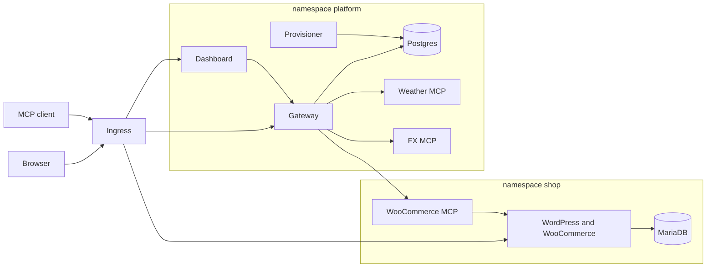

# AgentDock

WooCommerce on Kubernetes, with a team MCP gateway in front of it. An admin registers MCP servers once. Every teammate uses them through one gateway URL, or through the chat agent in the dashboard.

The WooCommerce MCP server in this repo is ours. It speaks Streamable HTTP and calls the store with the WooCommerce REST API. Weather and FX are two more upstreams so the gateway has three servers to aggregate.

A user can also create more stores from the dashboard. Each one is provisioned in its own namespace and registered with the gateway.

## Architecture

One Helm chart, `deploy/helm/urumi`, installs every workload. Local Kind and the public k3s node run that same chart. The difference is the values file: ingress class, hostnames, TLS, image tags, and the secrets file.



Public traffic stops at the Ingress. The shop host goes to WordPress. The app host sends `/` to the dashboard and `/api` and `/mcp` to the gateway. MariaDB, Postgres, and every MCP Service are ClusterIP. Nothing outside the cluster can open them.

Inside the cluster the path for a store tool is: the caller hits the gateway, the gateway checks the API key or the OAuth token, the gateway opens its own Streamable HTTP client to the WooCommerce MCP server, and that server calls the WooCommerce REST API on WordPress. WordPress reads and writes MariaDB. Weather and FX follow the same gateway hop and then call Open-Meteo and Frankfurter. Chat adds one more hop: the gateway sends the conversation to Groq, Groq asks for a tool, and the gateway runs that tool as the signed-in user.

Extra stores repeat the shop shape in a `store-<slug>` namespace. The provisioner creates them from a Postgres row. Hosted MCP images repeat a smaller shape in a `hosted-<slug>` namespace: one Deployment, one Service, and a NetworkPolicy that admits only the gateway.

## Why these choices

The store is stock WordPress plus WooCommerce, on persistent volumes, so the assignment is a real stateful app. The WooCommerce MCP server in this repo is the one we wrote. It speaks Streamable HTTP and calls REST with the consumer key. REST stays on HTTP, so the gateway's timeout bounds a slow store call, and the MCP server never execs into the WordPress container.

The gateway is both an MCP client and an MCP server. Teammates and the chat agent have one URL. Upstream URLs and consumer keys stay in Postgres as AES-GCM ciphertext, or in the Kubernetes Secret mounted on that MCP pod. The caller's `urk_` key is checked and then dropped. It is not copied onto the upstream request.

Tool names are `{slug}__{tool}`. Two stores can both expose `list_orders` and the gateway can still tell them apart. `tools/list` asks every enabled server at once and keeps the ones that answer within 3 seconds, so one dead upstream does not empty the catalog. A tool call times out after 20 seconds and comes back as a tool error. The gateway process stays up.

MCP sessions are stateless. Each request builds a new transport, and the tokens live in Postgres. The gateway Deployment runs two replicas, and either replica can serve the next call. There is no session affinity.

NetworkPolicies start from default-deny in `shop`, `platform`, each `store-*` namespace, and each `hosted-*` namespace. The allows are DNS, the ingress controller, the gateway, and each database's own clients. Kind 0.33's kindnet enforces those policies. k3s enforces them with kube-router. `kube-system` and the ingress namespace stay open so DNS and the ingress controller keep working.

WordPress runs as uid 33 and listens on 8080. MariaDB runs as uid 999. Postgres runs as uid 70. The Node services run as non-root. The Service in front of WordPress is still port 80. It targets the named port on 8080, because uid 33 cannot bind port 80.

Public TLS is cert-manager with a Let's Encrypt ClusterIssuer. The certificate is stored as `agentdock-tls`. Local Kind uses a certificate trusted on this computer, because Let's Encrypt cannot validate `localtest.me`.

Chat uses Groq (`openai/gpt-oss-120b`). When the catalog grows past 8 tools, the model is given `search_tools` and `call_tool` only. `search_tools` queries an inverted index of names and descriptions in `apps/gateway/src/search.ts`.

Longer notes are in `docs/system-design.md` and `docs/threat-model.md`.

## What runs where

| Namespace | Workload | Reachable from |
| --- | --- | --- |
| `shop` | MariaDB (PVC) | WordPress and the bootstrap Job |
| `shop` | WordPress + WooCommerce (PVC) | Ingress, and the WooCommerce MCP server |
| `shop` | WooCommerce MCP server | Gateway pods only |
| `platform` | Postgres (PVC) | Gateway and the provisioner |
| `platform` | Gateway | Ingress `/api` and `/mcp` |
| `platform` | Provisioner | Kubernetes API. Creates `store-*` namespaces |
| `platform` | Dashboard | Ingress `/` |
| `platform` | Weather MCP, FX MCP | Gateway pods only |

NetworkPolicies enforce the "only the gateway" rows. Everything else is ClusterIP with no Ingress. Public URLs are the storefront and the dashboard.

Local domains use [localtest.me](https://localtest.me), which resolves `*.localtest.me` to `127.0.0.1`. No hosts-file entry is required when that DNS name resolves. If you are offline, add:

```
127.0.0.1 shop.localtest.me app.localtest.me
```

Kind maps host ports 80 and 443 to the ingress controller. Local URLs are `https://shop.localtest.me` and `https://app.localtest.me`. The setup script installs a certificate for `*.localtest.me` and trusts it for the current Windows user, so the browser shows the lock. Plain `http://` redirects to `https://`.

## Local setup

Install Docker Desktop, [kind](https://kind.sigs.k8s.io/) 0.33 or newer, kubectl, Helm 3, and Node 22 or newer. Ports 80 and 443 on the host must be free. Kind 0.33 is the version whose kindnet enforces NetworkPolicy.

```powershell
.\deploy\scripts\up-local.ps1
```

On bash:

```bash
bash deploy/scripts/up-local.sh
```

The script creates a Kind cluster named `agentdock`, installs the local-path provisioner and ingress-nginx, builds the six app images, loads them into Kind, generates `deploy/helm/urumi/secrets.local.yaml` if it is missing, and installs the chart. The same chart is `deploy/helm/urumi`, with `values-local.yaml` for this cluster.

Paste a Groq API key into `secrets.groqApiKey` in that file before you use chat, then upgrade:

```powershell
helm upgrade agentdock deploy/helm/urumi -n agentdock --timeout 20m -f deploy/helm/urumi/values-local.yaml -f deploy/helm/urumi/secrets.local.yaml
```

`secrets.local.yaml` is gitignored. `secrets.example.yaml` shows the shape. Passwords are generated. Read them with:

```powershell
kubectl -n platform get secret gateway -o jsonpath="{.data.ADMIN_PASSWORD}" | %{ [Text.Encoding]::UTF8.GetString([Convert]::FromBase64String($_)) }
kubectl -n shop get secret shop -o jsonpath="{.data.WORDPRESS_ADMIN_PASSWORD}" | %{ [Text.Encoding]::UTF8.GetString([Convert]::FromBase64String($_)) }
```

Gateway login is `admin@agentdock.local` plus `ADMIN_PASSWORD`. WordPress admin user is `shopadmin` plus `WORDPRESS_ADMIN_PASSWORD`.

The bootstrap Job installs WooCommerce, enables cash on delivery, and creates a sample product named Classic Tee. Watch it with:

```powershell
kubectl -n shop logs job/wc-bootstrap
```

## Place an order

1. Open https://shop.localtest.me
2. Open Classic Tee, add it to the cart, and check out.
3. Pay with cash on delivery. Guest checkout is enabled.
4. Confirm the order in WordPress admin at https://shop.localtest.me/wp-admin

## Chat agent

Sign in to https://app.localtest.me as the admin (user A). Open Chat.

Ask it to create a product with a name and a price, for example: "Create a product called Running Shoes for 49.00". The product should appear on the storefront. Place an order for it by hand, then ask: "What orders came in today?" The agent calls `woocommerce__list_orders`. The tool names it used are shown on the reply, and the audit log attributes the calls to that user.

A prompt that needs two upstreams: "What is today's order total in EUR?" That uses WooCommerce and `fx__convert`.

## External MCP client

Invite a second user on Members (role member). Sign in as that user and create an API key. The full key is shown once.

In Cursor, Claude Code, or MCP Inspector, add one server:

- URL: `https://app.localtest.me/mcp`
- Header: `Authorization: Bearer urk_...`

`tools/list` returns every enabled server, with names prefixed by the server slug (`woocommerce__list_orders`, `weather__get_forecast`, `fx__convert`). Ask the same orders question, then a prompt that needs two servers.

There is no setting for the WooCommerce, weather, or FX URLs in the client. Those credentials stay on the gateway.

## Revoke, disable, kill

- Revoke user B's key on API keys. The next MCP call returns 401.
- Disable Weather. Its tools disappear from Chat and from `tools/list`. WooCommerce and FX still answer.
- `kubectl -n platform delete pod -l app.kubernetes.io/name=weather-mcp`. Within about 10 seconds the dashboard shows Weather as unreachable, with the error string. The other servers keep working. Click Refresh status if you do not want to wait for the poller.
- Audit log lists who called which server and tool, when, how long, and whether it succeeded.

## Production-like VPS (k3s)

k3s already provides Traefik and the `local-path` StorageClass. Do not install ingress-nginx there.

1. Install k3s and Helm on the VPS.
2. Build the images and either push them to a registry or import them:

```bash
docker save agentdock/gateway:1.0.0 | sudo k3s ctr images import -
```

Use the image names in `deploy/helm/urumi/values-prod.yaml`, or change that file. Also set the real shop and app hostnames. Point DNS at the VPS. Install cert-manager and a Let's Encrypt ClusterIssuer named `letsencrypt`. The prod values set `ingress.tls.certManager: true`, so the Ingress asks cert-manager for the certificate instead of Traefik's built-in resolver. Keep HTTP-01 reachable: do not redirect port 80 to HTTPS on the Traefik entrypoint itself. The chart adds a redirect middleware on the shop and dashboard Ingress only. `gateway.cookieSecure` is `true`, and `wordpress.url` is `https://`.

3. Copy `secrets.example.yaml` to `/etc/agentdock/secrets.yaml` on the server and fill it in. Do not commit it.
4. Install the same chart:

```bash
export KUBECONFIG=/etc/rancher/k3s/k3s.yaml
helm upgrade --install agentdock deploy/helm/urumi \
  --namespace agentdock --create-namespace --timeout 20m \
  -f deploy/helm/urumi/values-prod.yaml \
  -f /etc/agentdock/secrets.yaml
```

What changed is values only: ingress class and controller namespace, DNS hosts, the public URLs, the secure cookie flag, image names, and the secrets file. Storage class `local-path` matches what k3s installs. Kind installs that provisioner in the local script because Kind does not ship one.

Upgrade and roll back with Helm. Volumes are claims, so a rollback does not delete the store.

```bash
helm upgrade agentdock deploy/helm/urumi -n agentdock --timeout 20m \
  -f deploy/helm/urumi/values-prod.yaml -f /etc/agentdock/secrets.yaml
helm history agentdock -n agentdock
helm rollback agentdock <revision> -n agentdock
```

The WooCommerce bootstrap Job is an idempotent post-upgrade hook. It will not create a second API key or a second sample product. Dump the database before a WordPress or WooCommerce major upgrade. Rolling back the chart restores the previous images. It does not reverse a WordPress schema migration.

## How the WooCommerce MCP server talks to the store

REST API v3, HTTP Basic with the consumer key from the Secret. The bootstrap Job inserts the matching hashed key into `wp_woocommerce_api_keys`. REST is used instead of WP-CLI so a slow store call is an HTTP timeout the gateway can enforce, and so the MCP server never execs into the WordPress container.

Tool names on that server, before the gateway prefixes them: `list_products`, `create_product`, `list_orders`, `get_order`, `update_order_status`.

## Layout

- `apps/woocommerce-mcp` — store tools
- `apps/weather-mcp`, `apps/fx-mcp` — the other two upstreams
- `apps/gateway` — MCP endpoint, team API, audit, Groq chat loop
- `apps/dashboard` — React UI
- `deploy/helm/urumi` — chart, `values-local.yaml`, `values-prod.yaml`
- `docs/system-design.md` — aggregation, routing, failures, production values
- `docs/threat-model.md` — credentials, untrusted servers, members

## Tests without a cluster

```powershell
npm test
```

That builds the services and checks the WooCommerce tool path against a fake REST server, tool-name prefixing, a dead upstream being dropped from the list, credential encryption, and live Streamable HTTP calls to weather and FX.

## Extra stores

Open Stores in the dashboard. Enter a store name and the WooCommerce admin password twice. The username is `shopadmin`. Several stores can be created together. The row moves from Provisioning to Ready, or to Failed with a reason. Retry continues in the same namespace. Delete removes the namespace, its volumes and Secrets, and the store's MCP registration.

A store named East is published at `https://east.localtest.me`. Its tools are prefixed with the store slug, so `east__list_orders` is a different store from `woocommerce__list_orders`. The Stores row shows the exact prefix. Ask chat: "Compare today's orders in the platform store and East." Then delete East and refresh Servers. Those tools are gone, and `kubectl get ns` no longer lists `store-east`.

Each store namespace has its own MariaDB, WordPress, WooCommerce MCP server, Ingress, ResourceQuota, and LimitRange. NetworkPolicies allow the MCP server to reach only its own WordPress and DNS, and allow MariaDB only from WordPress and the bootstrap Job in that namespace. A user can own at most 3 stores. Provisioning fails cleanly after 15 minutes and can be retried. The provisioner is safe to restart while a store is still provisioning.

On a public host, set `stores.hostSuffix` and `stores.urlScheme` in `values-prod.yaml`. The suffix needs a wildcard DNS name.

## Stand-out items

- **Live k3s deploy.** The same chart runs on one EC2 instance. Public addresses are `https://app.34.203.65.66.nip.io` and `https://shop.34.203.65.66.nip.io`. TLS is cert-manager with Let's Encrypt. What changed is `values-prod.yaml`: ingress class, hosts, HTTPS URLs, the secure cookie, and image tags.
- **Per-role tools.** Members can list and read. `create_*`, `update_*`, `delete_*`, and `remove_*` are hidden from a member's tool list and rejected if called. See `apps/gateway/src/permissions.ts`.
- **OAuth.** MCP clients can use the browser login instead of an API key. Discovery is `/.well-known/oauth-protected-resource` and `/.well-known/oauth-authorization-server`. The flow is authorization code with PKCE. See `apps/gateway/src/oauth.ts`.
- **Many tools.** `search_tools` queries an inverted index of tool names and descriptions, then `call_tool` runs the match. When the catalog is larger than 8 tools, chat gives the model only those two. See `apps/gateway/src/search.ts`.
- **Two gateway replicas and rate limits.** `gateway.replicas` is 2. Sessions are stateless and tokens live in Postgres, so either replica can serve a call. Each user gets 120 MCP or chat requests a minute (`RATE_LIMIT_PER_MINUTE`).
- **Metrics.** The Metrics page and `GET /metrics` show calls, errors, and latency per server.
- **Hosted images.** On Servers, Deploy from an image. The provisioner creates a `hosted-*` namespace with a Secret, limits, and a NetworkPolicy, registers the MCP URL, and deletes the namespace when you remove it.

Production TLS is cert-manager with the Let's Encrypt issuer. The chart sets `ingress.tls.certManager` and stores the certificate in `agentdock-tls`. Local Kind uses a certificate trusted on this computer, because Let's Encrypt cannot validate `localtest.me`.
